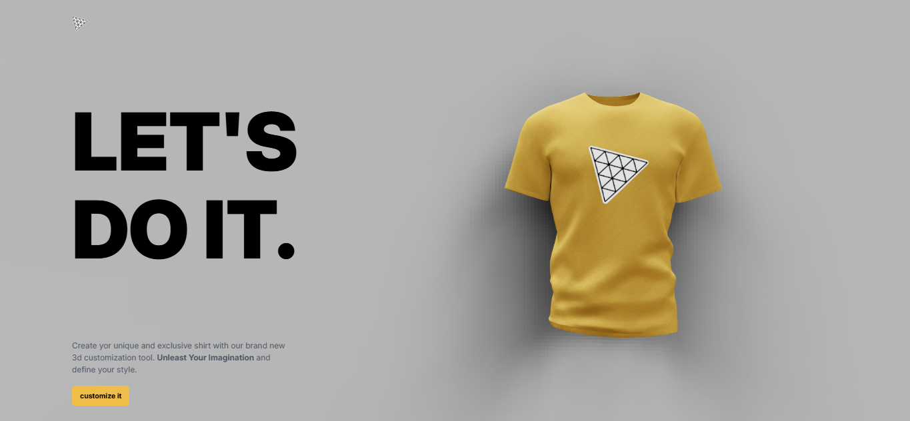
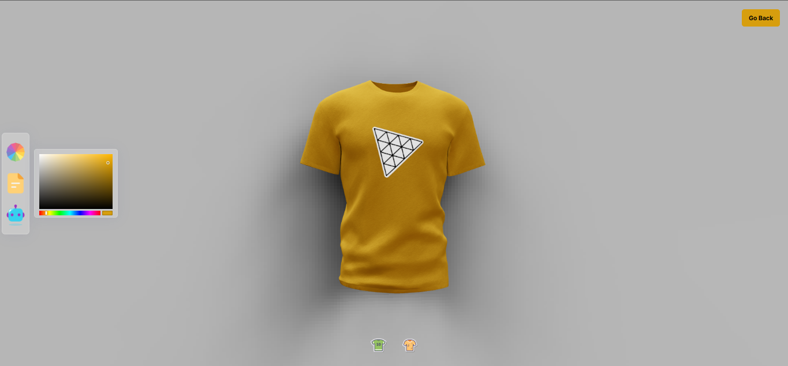

# TeeLab — 3D T-Shirt Customizer

An interactive shirt-design prototype built with **React, Vite, and Three.js**. It presents a 3D shirt preview and lets visitors customize its appearance with color and image decals, then export the canvas image.



## Features

- Interactive 3D shirt scene
- Shirt color selection
- Logo and full-surface decal modes
- Upload a local image to use as a decal
- Download the customized canvas as an image
- Animated intro and editor transitions

The editor also includes an AI picker tab, which is currently a placeholder component.

## Tech stack

- React and Vite
- Three.js with React Three Fiber and Drei
- Valtio for shared editor state
- Framer Motion for transitions
- Tailwind CSS

## Run locally

```bash
cd client
npm install
npm run dev
```

Open the local URL printed by Vite. `npm run build` creates a production build in `client/dist/`.

## Screenshots



## Project layout

The React app and its package scripts are in `client/`. Components, 3D canvas pieces, page views, configuration, and shared state live under `client/src/`; static 3D and image assets live under `client/public/` and `client/src/assets/`.
